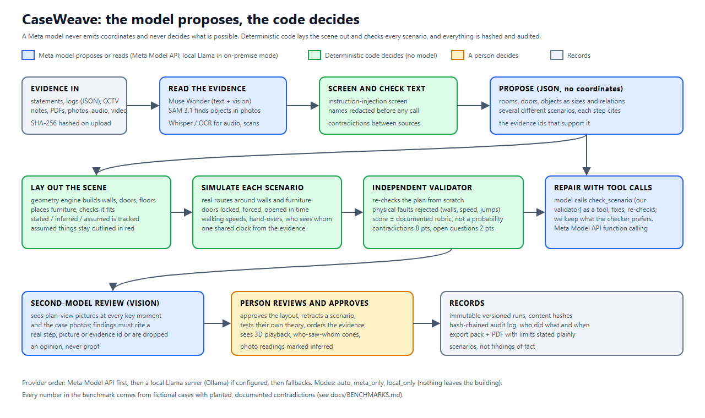

# CaseWeave

**Evidence in. A 3D reconstruction out, where a model proposes and code decides what is possible.**

CaseWeave turns the scattered material of an incident (statements, logs, CCTV notes, photographs, examiner's reports) into a walkable 3D scene and several *different* possible accounts of what happened. Each account is checked by deterministic code against real walls, doors, walking speeds and the evidence clocks, and every claim cites the evidence it rests on. It is a tool for **investigators to test accounts against the evidence**. It does not decide who is guilty and it does not give legal advice.

Built for the Meta AI Developer Hackathon. Everything shown in the demo and in the benchmarks uses **fictional cases**.

| | |
|---|---|
| Demo video (3 min) | _add the link before submitting_ |
| Architecture | [docs/architecture.svg](docs/architecture.svg) |
| Measured results | [docs/BENCHMARKS.md](docs/BENCHMARKS.md) |
| How we know it is right (and where it is not) | [docs/HOW_WE_KNOW_IT_IS_RIGHT.md](docs/HOW_WE_KNOW_IT_IS_RIGHT.md) |
| Third-party models and licences | [frontend/public/models/LICENSES.md](frontend/public/models/LICENSES.md) |



## The problem

Investigators reconcile statements, device logs and photographs by hand, and the contradictions between them are easy to miss. Some context from India's own statistics (NCRB, *Crime in India 2022*, Table 1A.5): police had **56,59,787 IPC cases under investigation** in 2022 and disposed of 36,60,786 of them, which leaves about **20 lakh (roughly 35%) still open at year end** (our arithmetic from NCRB's figures). The Bureau of Police Research & Development reports about **5.3 lakh vacancies in a sanctioned force of 26.2 lakh** (about 20%, Data on Police Organisations as on 1 Jan 2020, PIB). We found **no published figure for how many hours scene reconstruction takes per case**, so we do not claim one. The claim is narrower: reading every source against every other source is slow and error-prone, and a tool that does it consistently, with citations, is useful.

## Where Meta's models and tools are used

| Use | Meta component | Why it matters |
|---|---|---|
| Reading every evidence item, building the observation table, proposing the scene layout and several scenarios | **Muse Wonder** through the Meta Model API (`/v1/responses`) | The model reads and proposes. It never emits coordinates. |
| Reading the case photographs into a short, checked list of what is visible | **Muse Wonder vision**, same API | Qualitative only, marked *inferred*, never used for sizes. |
| Finding the scene's objects in the case photographs (boxes drawn on the photo) | **SAM 3.1** (hosted) | Boxes are filtered, marked inferred, hashed, audited. |
| A second, independent review of every scenario, with plan-view pictures at every key moment | **Muse Wonder vision**, multi-image | Findings must cite a real step, picture or evidence id or they are dropped. |
| Repairing a scenario as an **agent**: the model calls our validator as a tool, reads what is still wrong, fixes, re-checks | **Meta Model API function calling** | The model proposes, our checker decides, and we keep whichever version the checker prefers. |
| Running the whole pipeline with nothing leaving the building | **Llama 3.1 (8B)** on a local server (Ollama) | `LLM_PROVIDER_MODE=local_only`. A side-by-side with Meta-only is in the benchmarks. |

Provider order is Meta first, then a local Llama server if configured, then fallbacks. `LLM_PROVIDER_MODE` can be `auto`, `meta_only` or `local_only`, and the screen shows which was used for every scene.

## What it does

- **3D scene and playback** from the evidence, with every size marked *stated*, *inferred* or *assumed* (assumed objects stay plain with a red outline).
- **Several genuinely different scenarios**, each scored by a documented rubric (not a probability) and each citing evidence per step.
- **Independent checker**: routes around walls and furniture, locked and forced doors, walking speeds, hand-overs, line of sight. Physical impossibilities are rejected by code, not by opinion.
- **Who could see whom**: every camera and witness has a view cone that stays calm until someone is in view.
- **Contradictions between sources** (for example a statement against a door log), each pointing at both sources.
- **Second-model review**, **photo readings and photo boxes**, **officer's own theory** tested against the evidence, **audit trail**, **export pack and PDF**.

## Try it (no setup of your own data needed)

Three fictional cases are in [backend/data/synthetic_cases](backend/data/synthetic_cases): a night burglary, a two-vehicle collision at a signalled junction, and an assault in an office storeroom. Each has different kinds of evidence and a few contradictions planted on purpose, listed in its `ground_truth.json`. Load one with:

```bash
cd backend
python scripts/synthetic_cases_run.py burglary_warehouse meta_only
```

## Run it

Requires Python 3.11, Node 20, Docker, and a Meta Model API key.

```bash
cp backend/.env.example backend/.env       # set META_API_KEY, MYSQL_* and optionally REDIS_PASSWORD
export MYSQL_ROOT_PASSWORD=... MYSQL_PASSWORD=...
pip install -r backend/requirements.txt
./run_all.sh                                # Windows: run_all.bat
```

This starts MySQL and Redis in Docker (bound to this machine only), the API on `127.0.0.1:8010`, the worker, and the web app on `http://localhost:3000`. The first admin password is `CASEWEAVE_ADMIN_PASSWORD` if you set it; otherwise the account starts on a shipped default and is forced to choose a new password at first sign-in.

Nothing is hardcoded to one case. Secrets live in `backend/.env` (never committed).

## Tests and measurements

```bash
cd backend && MYSQL_DATABASE=caseweave_test python -m pytest tests -q     # needs a throwaway test database
python scripts/sandbox_eval.py 2500                                      # 2,500 random scenes: determinism, planted-fault detection, false alarms
python scripts/sandbox_benchmark.py report                               # writes docs/BENCHMARKS.md from the measured runs
```

The test suite refuses to run against a database whose name does not contain `test`.

## Limits, said plainly

- Scenarios are **possibilities consistent with the evidence**, not findings of fact. A scenario can be consistent and still wrong.
- The second-model reviewer is an opinion from the same model family. "Nothing found" is not proof.
- Photo readings and photo boxes are inferred and are never used for measurements.
- The scene is as good as the sizes in the evidence. Where the evidence is silent, the scene says *assumed* and draws it plainly.
- Only fictional cases have been run. It has not been validated on real cases with investigators.
- The bundled legal summaries are paraphrases for reference, not the Acts' text. They are not legal advice and need checking by a lawyer. They are not part of the demo.
- Do not use it for identification of people, behaviour scoring, or any purpose other than testing accounts of an incident against recorded evidence.

## Repository layout

```
backend/            FastAPI API, pipeline stages, geometry engine, validator, reviewer, tests
  pipeline/sandbox*.py   layout, scenarios, checker, repair agent, review, photo links
  data/synthetic_cases/  fictional demonstration cases + ground truth + measured results
  scripts/               evaluation, benchmark, case runner
frontend/           Next.js 16 / React Three Fiber web app (3D player in app/scene)
docs/               architecture, benchmarks, how we know it is right
```

Earlier notes on the full pipeline stages are in [docs/PIPELINE_STAGES.md](docs/PIPELINE_STAGES.md).

## Licence

MIT. Third-party 3D models are CC BY 4.0 from the Khronos glTF Sample Assets (credits in `frontend/public/models/LICENSES.md`).
