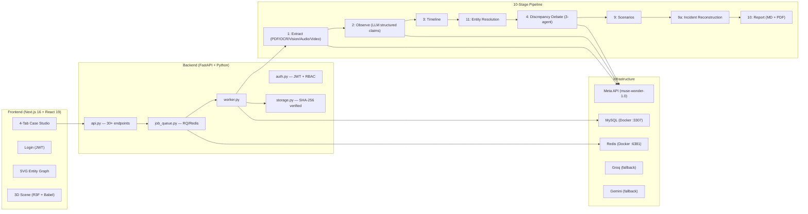

# CaseWeave AI — Project Status & Next Steps

## What It Is

An AI-powered investigation/evidence-analysis workspace for police departments (India/Tamil Nadu context). **Not** a replacement for FIR systems, chain-of-custody software, or court case management — it's an **AI reasoning layer** over evidence a department already has. It reads evidence (text, PDFs, photos, audio, video), extracts structured facts, builds timelines, finds contradictions via a 3-agent debate, resolves entities, and produces sourced reports.

> [!IMPORTANT]
> **Honest pitch:** "This finds contradictions and gaps faster and more consistently than manual review, and cites its sources so you can verify everything — it does not replace investigation, verification, or judgment."

---

## Architecture At a Glance



---

## What's Done (Verified Live) ✅

### Core Pipeline (Stages 0–11)
| Stage | What | Verified |
|-------|------|----------|
| 0 | Foundation — FastAPI, Next.js, MySQL, audit log, object store | ✅ |
| 1 | Media extraction — PDF/OCR/image **vision**/audio (Whisper)/video | ✅ (image vision fix was critical) |
| 2 | Observation engine — LLM-structured factual claims per evidence | ✅ |
| 2a | Entity extraction fields in observations | ✅ |
| 2.5 | Evidence-grounded case chat (RAG, multi-turn) | ✅ |
| 3 | Timeline builder (separate read-only `get_timeline()`) | ✅ |
| 4 | **3-agent debate** (Prosecutor/Defender/Judge) — 3/3 reliability | ✅ |
| 4a | Conflict review workflow (requires reason, full history) | ✅ |
| 4b | Positive evidence linking (supports/related_to/corroborates) | ✅ |
| 5 | Legal retrieval (MiniLM + ChromaDB RAG) | ✅ |
| 6 | Procedural 3D scene shell (R3F JSX, runtime Babel compile) | ✅ |
| 7 | Object reconstruction (procedural, single combined) | ✅ |
| 8 | SAM 3.1 segmentation | ✅ backend only, **no UI** |
| 9 | Competing scenario generation per conflict | ✅ |
| 9a | Incident reconstruction (confidence-scored gaps) | ✅ |
| 10 | Report — Markdown + formatted PDF (reportlab) | ✅ |
| 11 | Entity resolution + SVG relationship graph | ✅ |

### Security & Ops (Stages 12–21)
| Stage | What | Status |
|-------|------|--------|
| 12 | JWT auth + RBAC (investigator/reviewer/admin) | ✅ |
| 13 | Secrets management (Windows Credential Manager + .env) | ✅ |
| 14 | Upload validation (magic bytes, size limits, path-traversal) | ✅ |
| 15 | TLS for localhost | ⚠️ Built, not active (cert script exists) |
| 16 | Rate limiting | ✅ |
| 17 | Structured logging | ✅ |
| 19 | Auto-backup post-processing | ✅ |
| 20 | MySQL + async RQ job queue | ✅ |
| 21 | Dependency vuln scanning (0 CVEs) | ✅ |

### 13-Item Punch List (All Complete)
All 13 user-reported issues fixed and individually verified with live testing:

1. ✅ Pipeline parse error (empty multipart → JSON body)
2. ✅ Scrollbar overlapping text (padding fix)
3. ✅ Timeline click scroll-into-view
4. ✅ Entity alias self-reference filter
5. ✅ Single combined reconstruction + **image vision bug fix**
6. ✅ Confidence-scored unresolved gaps
7. ✅ "Recommended next step" relabeling
8. ✅ Conflict review requires reason + audit history
9. ✅ Formatted PDF report (reportlab, not HTML→PDF)
10. ✅ Chain-of-custody view (from existing audit table)
11. ✅ Per-evidence custody summary (covered by #10)
12. ✅ Draft BSA s.63 electronic-evidence certificate
13. ✅ Structured witness statement intake form

### Bonus Fixes
- Delete-case endpoint (admin-only, full cascade)
- 401 auto-redirect to login
- Next.js 16 `useParams()` Suspense fix
- 3D scene Babel compile fix (classic JSX runtime + semicolon strip)
- Pipeline idempotency (DELETE before INSERT)
- Audit hash-chain fork fix (`GET_LOCK` serialization)
- MP4/MOV magic-byte offset fix
- LLM retry broadened (TimeoutError, URLError, etc.)
- Job timeout raised to 1800s

---

## What's NOT Done — Next Steps 🔲

### Immediate (Code-Level, You Can Do Now)

| Priority | Item | Notes |
|----------|------|-------|
| 🔴 High | **Run the test suite** | `backend/tests/test_pipeline.py` (22 tests) hasn't been run against this session's changes. Run and fix any regressions. |
| 🔴 High | **Stage 8 UI** — Wire SAM segmentation to API + frontend | Backend works, needs `POST /cases/{id}/segment` endpoint + UI button. Low priority per user but is a gap. |
| 🟡 Medium | **Stage 15 — Enable TLS** | Cert script exists. Just need to add `--ssl-certfile` / `--ssl-keyfile` to uvicorn startup. |
| 🟡 Medium | **CORS for deployment** | Currently locked to `localhost:3000`. Needs updating for any non-local deployment. |
| 🟡 Medium | **Automated CI** | Wire `pip-audit` + `npm audit` to run on every change (GitHub Actions or similar). |
| 🟢 Low | **Stage 22 — Stronger/paid LLM** | Current free-tier models work but a paid model would improve quality. |

### Requires External People (Can't Be Done With Code Alone)

| Priority | Item | Who's Needed |
|----------|------|--------------|
| 🔴 Critical | **Stage 18 — Data retention policy** | Legal counsel (what data to keep, how long, deletion rules) |
| 🔴 Critical | **Stage 23 — Legal sign-off** | Lawyer review of the tool's outputs, disclaimers, liability. **On explicit hold per user.** |
| 🔴 Critical | **Stage 24 — Penetration test** | External security firm |
| 🔴 Critical | **Stage 25 — Shadow pilot** | A real police unit running it alongside their normal process. **This is the actual finish line.** |

---

## Key Technical Decisions Worth Knowing

### 3-Agent Debate (Stage 4)
Single-pass LLM conflict detection was **measured at 1/4 reliability**. The Prosecutor/Defender/Judge debate with a shared `DECISION_RUBRIC` and entity-resolution grounding achieves **3/3 consistency**. Full debate transcripts are stored per conflict. Entity resolution (Stage 11) was reordered to run *before* the debate to provide grounding.

### Meta API Shape
Uses `https://api.meta.ai/v1/responses` with Responses API format (`input` field, not `messages` array). Model: `muse-wonder-1.0`. SAM 3.1 uses the same endpoint. **Not** the `api.llama.com` endpoint (that was a wrong guess that cost debugging time).

### Image Vision Fix
The single most impactful bug fix: `extract.py` previously only ran OCR on images — photos with no text (most evidence photos) were **silently skipped**. Now always runs a vision-description pass, combined with OCR when present.

### Frontend Design
One large file ([page.tsx](file:///c:/Users/VIGNESH/Downloads/CaseWeave/frontend/app/case/[caseId]/page.tsx), ~1,347 lines) with all state in `CaseStudio`, passed via props. Authenticated file downloads use `fetch() + blob URL` pattern since `` can't carry Bearer tokens.

---

## How to Start Everything

```bash
# 1. Docker containers
docker start caseweave-mysql caseweave-redis

# 2. Backend (from backend/)
cd "C:\Users\VIGNESH\Downloads\CaseWeave\backend"
py -3.11 -m uvicorn api:app --port 8010

# 3. Worker (REQUIRED for pipeline)
cd "C:\Users\VIGNESH\Downloads\CaseWeave\backend"
py -3.11 worker.py

# 4. Frontend
cd "C:\Users\VIGNESH\Downloads\CaseWeave\frontend"
npm run dev

# 5. Open http://localhost:3000 → admin / changeme123
```

> [!CAUTION]
> **Never kill the worker while a pipeline job is running** — a full run takes 10–20+ minutes with real LLM calls. No checkpoint/resume exists; killing it loses all work.

---

## Demo Case
**`CW-54F2FE` "Warehouse Incident Demo"** — 14 evidence items (6 photos, PDF, audio, video, text statements, access log), fully processed: 177 observations, 28 timeline events, 100 entities, 9 conflicts, 12 evidence links, real PDF report.
